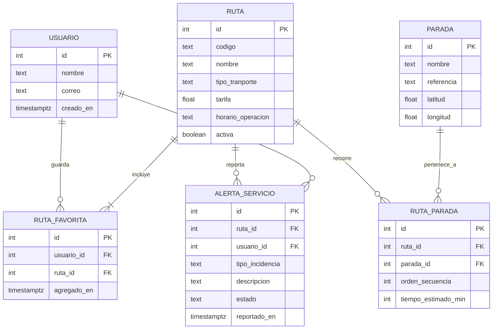

# PRD · Michisuji - Rutas de Transporte Público

> Documento de requisitos del producto (Product Requirements Document).
> Complétalo en el Sprint 0 (historia H0.3) y pide la aprobación del profesor en un Issue.
> Cada requisito funcional (RF) se convierte en un Issue con la plantilla "Historia de usuario".

| Campo | Valor |
| --- | --- |
| Alumno | Isaac Emmanuel Aponte Zerpa |
| Proyecto n.º | Lenguaje de Programción II - Rutas de Transporte Público |
| Sitio de referencia | Moovit |
| Compañero revisor | Ana Chacoa |
| URL desplegada | (se completa en el Sprint 5) |

## 1. Problema
• La complejidad de los sistemas de transporte urbano y la ausencia de datos centralizados impiden que los ciudadanos planifiquen sus viajes de manera eficiente. Como resultado, los usuarios sufren esperas prolongadas e incertidumbre al momento de realizar transbordos o viajar hacia zonas desconocidas.

## 2. Usuarios

- **Usuario principal:** Personas que investigan el transporte público, específicamente estudiantes y trabajadores de entre 18 y 45 años que no tienen vehículo propio y dependen del transporte público para sus traslados diarios.
- **Usuario secundario:** Personas nuevas en la ciudad que necesitan moverse de forma económica y segura sin conocer el idioma local o el funcionamiento del transporte de la zona.

## 3. Objetivo y métrica de éxito

Guiar a los usuarios del transporte público con rutas claras y tiempos precisos para viajes más rápidos y seguros.

## 4. Alcance del MVP

Entre 5 y 8 funcionalidades que SÍ entran este semestre.

1. Buscador de origen y destino.
2. Motor de cálculo de rutas y transbordos.
3. Guía de viaje paso a paso (Itinerario).
4. Mapa interactivo con trazado de líneas.
5. Estimación de tiempos de traslado (ETA).
6. Directorio de paradas y líneas cercanas.

### Funcionalidades → carpetas de `src/` (screaming architecture)

Cada funcionalidad del alcance será una carpeta en `src/`. Nómbralas en inglés y en plural.

| Funcionalidad | Carpeta |
| --- | --- |
| Líneas y rutas de transporte | `src/routes` |
| Planificador de viajes (origen-destino) | `src/planner` |
| Mapa interactivo y trazos | `src/maps` |
| Paradas, estaciones y horarios | `src/stops` |
| Rutas y paradas favoritas | `src/favorites` |
| Alertas y reportes de servicio | `src/alerts` |

## 5. Fuera de alcance

- Aplicación móvil nativa para iOS o Android (el proyecto es una aplicación web responsive).
- Rastreo GPS en tiempo real mediante hardware físico instalado en las unidades de transporte.
- Pasarela de pagos o recarga electrónica de tarjetas/boletos de transporte. 

## 6. Requisitos funcionales

| ID | Requisito | Prioridad (alta, media, baja) |
| --- | --- | --- |
| RF-01 | Buscar lineas y rutas de transporte público por nombre, número o usar geolocalización para ver opciones cercanas. | alta |
| RF-02 | Calcular la ruta óptima punto a punto entre un origen y un destino, indicando combinaciones y transbordos necesarios. | alta |
| RF-03 | Explorar un mapa interactivo con el trazado de las rutas, estaciones y paradas disponibles. | alta |
| RF-04 | Consultar el listado de paradas, horarios estimados de paso y tarifas vigentes de cada línea. | alta |
| RF-05 | Guardar y administrar una lista de rutas y paradas favoritas para acceso rápido. | media |
| RF-06 | Visualizar y publicar alertas o reportes comunitarios sobre desvíos, retrasos o estado del servicio. | media |
| RF-07 | Gestionar (crear, editar y eliminar) rutas, paradas y tarifas desde un panel administrativo. | baja |

## 7. Requisitos no funcionales

- Responsive, móvil primero (375 px y 1280 px).
- Lighthouse ≥ 90 en Accesibilidad y Buenas prácticas.
- 0 errores en la consola del navegador.
- Funciona con 10.000 registros sin congelarse.

## 8. Modelo de datos

Diagrama entidad-relación y tablas PostgreSQL con tipos, claves y restricciones.
GitHub dibuja diagramas Mermaid; edita este ejemplo:

## 9. Reto técnico distintivo

**Reto técnico distintivo (H9.1) – Procesamiento geoespacial y cálculo de rutas con transbordos**

El principal desafío técnico del proyecto consiste en procesar coordenadas geográficas y secuencias ordenadas de paradas para calcular viajes punto a punto (incluyendo combinaciones de múltiples líneas) de forma rápida y precisa sin depender de motores de enrutamiento de transporte público pagos.

Para resolverlo, el sistema implementará:

1. **Indexación y búsqueda por proximidad geoespacial:** Cálculo eficiente de distancias (mediante la fórmula de Haversine o extensiones espaciales en PostgreSQL) para identificar las paradas más cercanas al punto de origen y destino del usuario dentro de un radio caminable configurable.
2. **Construcción de grafo de conectividad y detección de transbordos:** Procesamiento de la tabla relacional `RUTA_PARADA` para modelar las líneas como un grafo dirigido, detectando intersecciones o paradas cercanas entre distintas rutas donde el pasajero pueda hacer transferencia.
3. **Algoritmo de enrutamiento multi-criterio:** Búsqueda de rutas óptimas ponderando el tiempo estimado de viaje (`tiempo_estimado_min`), la cantidad de transbordos necesarios y las alertas activas (`ALERTA_SERVICIO`) para penalizar o descartar líneas con desvíos o retrasos reportados.

## 10. Riesgos y preguntas abiertas

- Límites de tasa (*rate limits*) o latencia en las APIs externas de mapas, geocodificación y trazado de rutas peatonales al consultar múltiples combinaciones.
- Disponibilidad o cobertura irregular de datos oficiales sobre paradas formales, horarios de paso y cambios imprevistos en el recorrido de las unidades.
- Precisión y moderación de las alertas comunitarias reportadas por los usuarios (evitar reportes falsos, duplicados o desactualizados en tiempo real).
